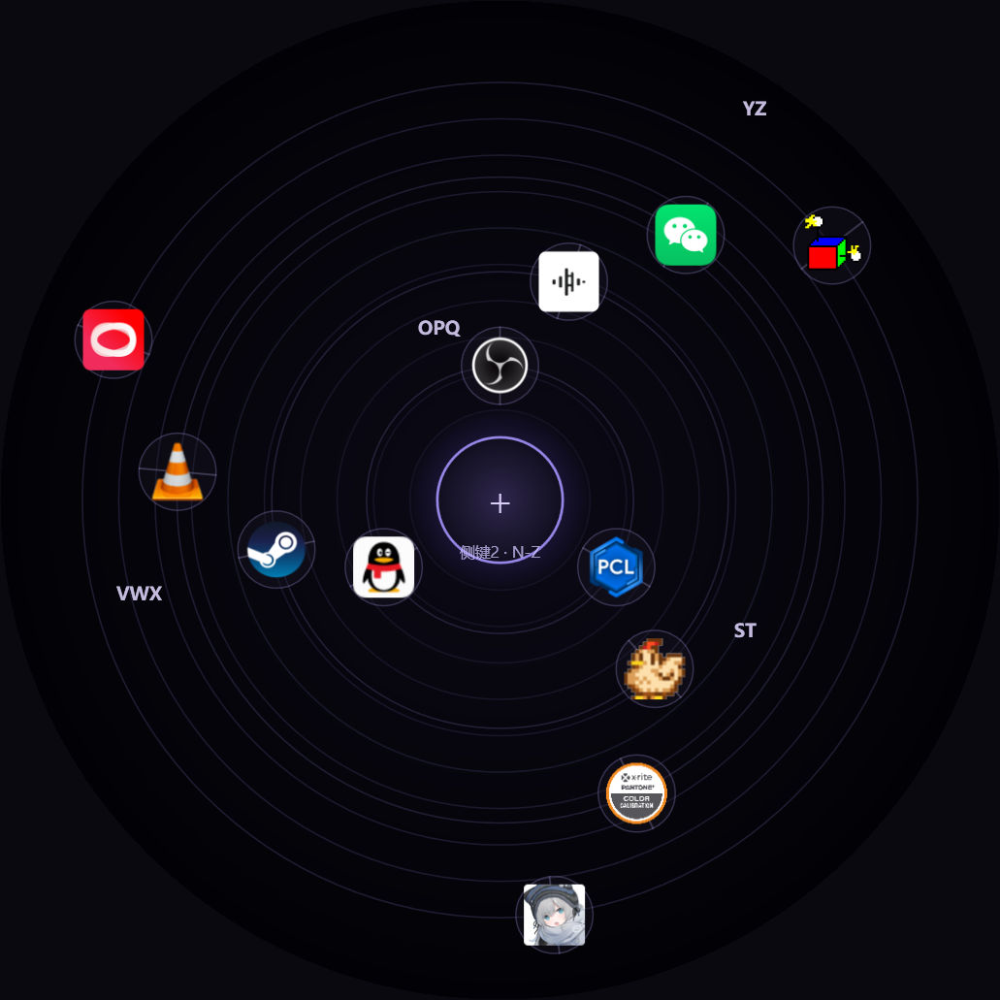
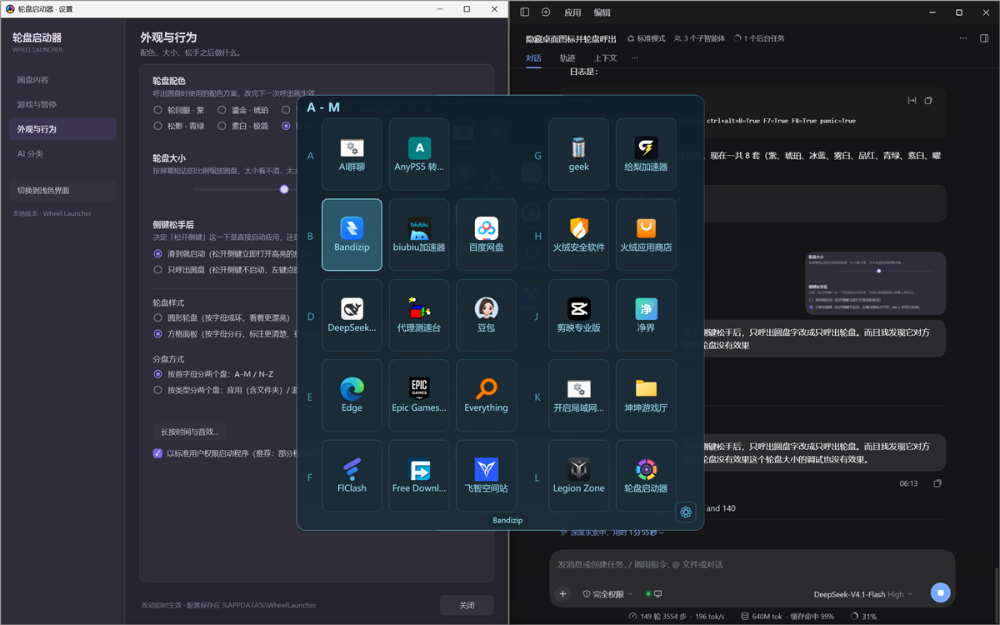
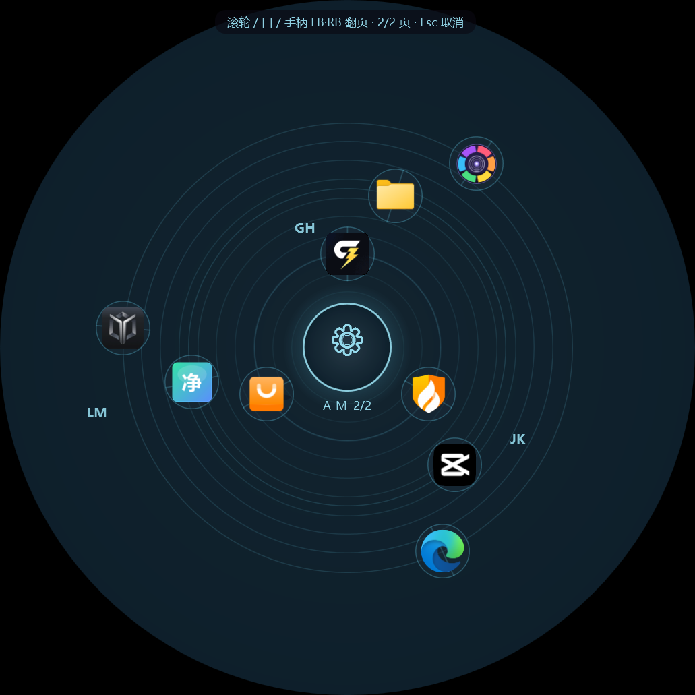

# 轮盘启动器 WheelLauncher

按住鼠标侧键（或 `F7` / `F8` / `Tab+A` / `Tab+B` / 手柄组合键）呼出启动盘，桌面应用按**首字母**排好，移过去松手就启动。不用桌面图标，也不用翻开始菜单。


## 下载

- **[WheelLauncher-v0.1.6-win-x64.zip](https://github.com/wodemi/wheel-launcher/releases/latest/download/WheelLauncher-v0.1.6-win-x64.zip)** — 约 200 KB，解压后双击 `WheelLauncher.exe` 就能用（.NET Framework 4.8 系统自带，无需安装任何运行库）。
- 历史版本与更新说明：[Releases](https://github.com/wodemi/wheel-launcher/releases)

## 截图

**圆形轮盘**（A–M / N–Z 两个盘，按首字母成环、由内向外扩散）

| 侧键 1 · A–M | 侧键 2 · N–Z |
| --- | --- |
|  |  |

**方格面板**（同一批应用按字母分行，点得更准）



应用多到一屏放不下时**自动分页**，顶部会显示 `2/3`：



设置台（左栏导航，深色 / 浅色一键切换）：

| 圆盘内容 | 游戏与暂停 |
| --- | --- |
|  |  |

## 功能

- **侧键呼出**：按住鼠标侧键超过设定时间（默认 650ms）才弹出，短按不误触；弹出后继续按住，移动鼠标选中，松手启动，`Esc` 取消。
- **两种盘型**（设置 → 外观与行为 → 轮盘样式）：
  - 圆形轮盘：按首字母成环，由内向外扩散，好看；
  - 方格面板：按字母分行，格子对齐，点多的时候更容易点准。
- **两种松手行为**（同一页）：滑到就启动（默认）/ 只呼出圆盘（左键点图标才启动）。
- **拥挤才分页**：一屏装得下就完全不分页；只有当圆环弧长挤不下图标、或方格行数超出一屏时，才切成多页，用**滚轮 / `[` `]` / 手柄 LB·RB** 翻页，中心显示页码。
- **全键盘操作**：`Tab+A`（A–M）或 `Tab+B`（N–Z）呼出后，用 **W A S D** 像走方向一样在图标间移动（可斜向），**Enter** 启动，朝圆心方向按可选中中心齿轮，`Esc` 关闭。
- **手柄操作**：`L3 + 视图键` 呼出 A–M，`L3 + 菜单键` 呼出 N–Z；左摇杆连续移动光标（丝滑），十字键逐格移动，`A` 确认，`B` 取消，`LB/RB` 翻页。摇杆到边界会停在边缘应用上，不会丢失选中。
- **备用热键**：`F7` = A–M，`F8` = N–Z，`Ctrl+Alt+A/B` 也注册了（如果被其它软件占用则失效，不影响 F7/F8）。
- **高权限窗口不卡**：支持以管理员身份运行（托盘菜单「以管理员身份重启」），这样在加速器、反作弊游戏等高权限窗口前也能正常呼出。
- **加速器前台自动让开**：检测到 biubiu、UU、迅游、雷神等加速器在前台时，侧键与热键全部放行，不弹盘、不吞键（可在设置里关掉）。
- **游戏自动让路**：识别游戏目录 / Steam·Epic 启动的游戏 / D3D 全屏 / 无边框全屏，命中时轮盘不弹、按键原样放行；「平台窗口也暂停」可单独开关。
- **设置台**（中心齿轮或托盘菜单进入）：圆盘内容（增删文件 / 文件夹 / 自动收录）、游戏与暂停、外观与行为（6 套配色、大小 70–140%、松手行为、盘型、主题）。
- **其它**：托盘常驻、开机自启（管理员、无 UAC 提示）、每 3 分钟自动重扫桌面、选中音效（音量可调）、深色 / 浅色界面。

## 使用方法

1. 解压后双击 `WheelLauncher.exe`，首次运行会弹使用引导窗。
2. 按住鼠标侧键约 0.65 秒，启动盘出现；继续按住，移到目标图标，松手。
3. 没有侧键：按 `F7` / `F8`，或用 `Tab+A` / `Tab+B` 呼出，然后鼠标点或 `WASD`+`Enter`。
4. 调判定时间 / 音量 / 音效：托盘右键 →「长按与音效…」；改内容 / 游戏 / 外观：托盘右键 →「圆盘设置…」，或呼出后点中心齿轮。

设置与自定义数据保存在 `%APPDATA%\WheelLauncher\`：

- `settings.ini`：`longpress`（250–2000ms）、`volume`（0–100）、`sound`（0/1）、`tabhotkey`（0/1）、`theme`（0 浅色 / 1 深色）、`wheeltheme`（0–5 配色）、`wheelsize`（70–140）、`wheelstyle`（0 圆形 / 1 方格）、`release`（0 滑到就启动 / 1 只呼出）、`autofolders`、`autopause`、`pausestore`、`pauseaccel`、`firstrun`、`foldersseed`。
- `custom.txt`：手动添加的应用与文件夹，格式 `显示名|路径|启动参数`。
- `games.txt`：手动标记为游戏的文件 / 文件夹（每行一个路径）。
- `log.txt`：运行日志，排错时看这个。

## 构建

需要 Windows 10/11 x64 与 .NET Framework 4.8（系统自带），**不需要**安装 Visual Studio 或 .NET SDK。

```powershell
powershell -ExecutionPolicy Bypass -File .\build.ps1
```

`build.ps1` 调用系统自带的 `csc.exe` 编译成单文件 exe，并嵌入 `wheel.ico`。

## 已知限制

- **只支持 x64**，界面全中文。
- exe **未做代码签名**：首次运行 SmartScreen 会提示「未知发布者」，点「更多信息 → 仍要运行」即可。
- 程序会安装**全局键鼠钩子**（读取侧键与组合键的唯一办法），个别杀软可能提示「可疑行为」，需要手动放行。
- 侧键必须是 Windows 标准的 XBUTTON1 / XBUTTON2。用罗技 Options+、雷云等驱动把侧键改成了别的功能时，程序收不到。
- 多显示器各屏缩放比例不同时，尺寸与位置按呼出时所在屏幕的 DPI 计算，混用时可能有轻微偏差。
- 盘面覆盖的方形区域会接收左键：点图标=启动，点空白=关闭，点中心齿轮=设置。
- 纯本地程序，不联网、不上传任何数据。

## 许可证

MIT，见 [LICENSE](LICENSE).
