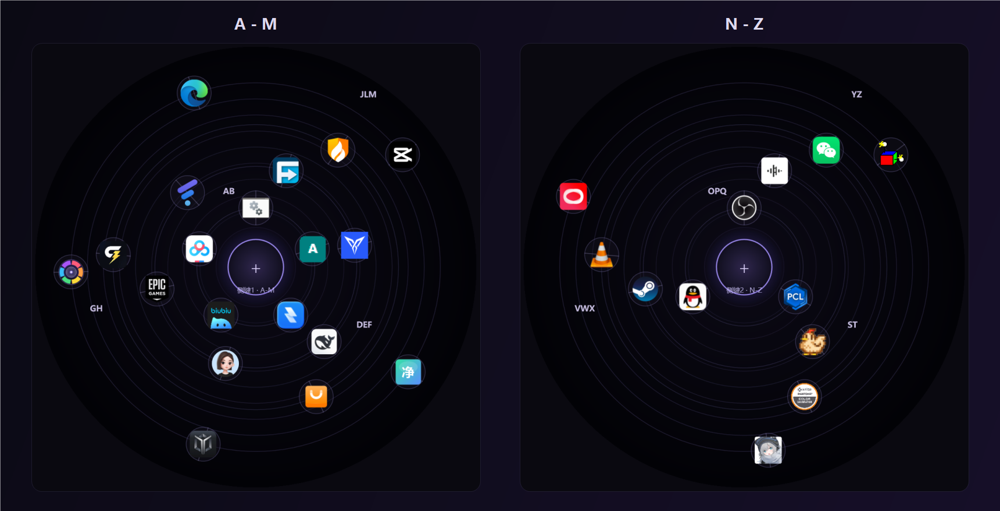
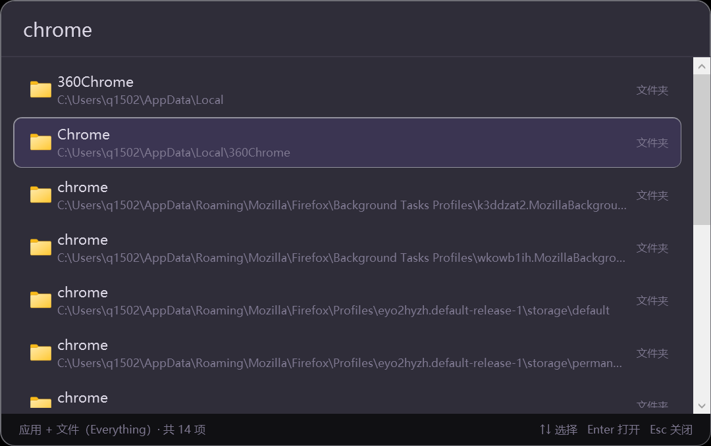

# 轮盘启动器 · Wheel Launcher

按住鼠标侧键（或按 `F7` / `F8`）呼出的大号径向启动器：一个圆盘按字母分区，滑到哪个就开哪个。
单文件、免安装、C# + WPF 手写，没有 .NET 运行时以外的依赖。


## 它是什么

Windows 上想开个程序，一般有三条路：翻开始菜单、找桌面图标、按 Win 敲名字。
这个工具给了第四条：**按住侧键 → 出现一个按首字母分好的大圆盘 → 鼠标往那一格一甩 → 松手就启动**。

- 默认把 `A–M` 放一个圆盘（侧键 1 / `F7`），`N–Z` 放另一个（侧键 2 / `F8`）
- 每个字母一环、从内向外排列，字母标签跟着环走
- 也可以切成**方格面板**，一屏看全、按字母分行，适合条目多的时候
- 中心是个齿轮，点一下打开设置；设置里能改配色、大小、松手行为、分类规则

## 功能

| 功能 | 说明 |
|---|---|
| 侧键呼出 | 按住鼠标侧键 0.65 秒出现圆盘，不拖动直接松手仍是原来的"后退"行为 |
| 键盘呼出 | `F7` = A–M，`F8` = N–Z，`Esc` 关闭，`Ctrl+Alt+A/B` 备用（可能与其他软件冲突） |
| 搜索 | `F9` 呼出搜索框，输入即出结果：先匹配本机应用（含拼音首字母），再接 Everything 搜全盘文件 |
| 圆盘打字 | 圆盘打开时直接敲字母/数字，会跳进搜索框继续输入 |
| 两种样式 | 圆形轮盘 / 方格面板，可在设置里切换 |
| 八套配色 | 轮回眼·紫、鎏金·琥珀、青霜·冰蓝、极简·雾白、赛博·品红、松影·青绿、素白·极简、曜黑·极简 |
| 大小调节 | 70%–140%，圆盘与方格共用（方格会随比例缩放瓦片、字号） |
| 松手行为 | 「滑到就启动」或「只呼出，左键点图标才启动」（后者支持 Esc / 点空白 / 再按侧键收起） |
| 系统入口 | 回收站、此电脑、控制面板、设备管理器、服务、任务管理器、注册表、磁盘管理、程序和功能…… 共 12 项，用真实系统图标 |
| 文件夹 | 可以把文件夹放到圆盘上（点开是资源管理器），也可以自动收录 文档/下载/桌面 等 |
| 置顶 / 隐藏 | 列表里右键可置顶、上移下移、隐藏；双击切换置顶 |
| AI 分类 | 接 OpenAI 兼容接口（火山方舟 / DeepSeek / OpenAI / 通义 / Kimi / 智谱 / 硅基流动 / 自定义），自动判断条目是游戏、应用还是文件夹，并可分别成盘 |
| 规则沉淀 | AI 判过的结果会写成"路径特征 → 类别"的本地规则，以后同类条目不再调用接口（省 token） |
| 游戏自动暂停 | 前台是游戏时侧键与 Tab 组合全部放行；识别方式：游戏目录、Steam/Epic 等平台的子进程、D3D 全屏、无边框满屏 |
| 加速器放行 | 可选：biubiu / UU / 迅游 等加速器窗口在前台时也不触发 |
| 手柄 | 手柄组合键也可呼出（含摇杆径向选择），游戏中自动停用 |
| 选中音效 | 48kHz 常驻音频流的"哒"声，可开关、可调音量 |
| 主题 | 设置界面深色 / 浅色两套，切换即时生效 |
| 急救键 | `Ctrl+Alt+Shift+F10` 强制关闭所有轮盘窗口（万一卡住） |

## 下载

到 [Releases](https://github.com/wodemi/wheel-launcher/releases/latest) 下载最新的 `WheelLauncher-v*-win-x64.zip`，解压即用，绿色免安装。

**系统要求**：Windows 10 / 11 x64。首次运行如果弹 SmartScreen（未签名程序都会弹），点「更多信息 → 仍要运行」。

## 使用

1. 双击 `WheelLauncher.exe`，托盘出现一个六色小圆盘图标
2. 按住鼠标**侧键**（侧面靠后的那颗，浏览器的"后退"键）0.65 秒 → 圆盘出现
3. 鼠标往目标图标方向移动，悬停会高亮并在中心显示名字 → **松开侧键即启动**
4. 不想要启动：松手前按 `Esc`，或移回中心再松手
5. 托盘图标 **左键单击** = 直接显示轮盘；**右键** = 菜单（设置 / 重扫 / 开机自启 / 退出）

没侧键的鼠标：用 `F7` / `F8`，或在设置里把长按时间调短。没有侧键时首次运行会提示。

### 中心齿轮

点圆盘正中间那个 `⚙` 打开设置，分四页：

- **圆盘内容**：看到圆盘上所有条目，可添加文件/文件夹、移除、重新扫描、置顶、隐藏、搜索
- **游戏与暂停**：哪些路径算游戏、是否在平台窗口前台时也暂停、加速器放行开关
- **外观与行为**：配色、大小、圆盘/方格、松手行为、分盘方式、是否用标准用户权限启动、搜索开关
- **AI 分类**：填接口地址/模型/Key，一键分类；可扫描收录文件夹与盘根目录，找出游戏库

### Everything 搜索（可选）

「搜索」默认开启：`F9` 呼出后，除了本机应用，还会用 [Everything](https://www.voidtools.com/) 搜全盘文件。

- 装了 Everything 但没装命令行工具 `es.exe` 时，搜索框底部会提示，**点一下就自动下载**（只下 es.exe，不打包 Everything 本体）
- 没装 Everything 时提示只能搜应用，并给出下载页链接
- 不想用可以在 设置 › 外观与行为 › 搜索 里关掉，关掉后不会启动任何外部进程

## 截图

| 圆盘（A–M / N–Z） | 方格面板 |
|---|---|
|  |  |

| 搜索（应用 + 文件） | 设置 · 外观与行为 |
|---|---|
|  |  |

## 数据都在哪

所有配置在 `%APPDATA%\WheelLauncher\`，纯文本，可手工改、可备份：

| 文件 | 内容 |
|---|---|
| `settings.ini` | 设置项（`key=value`） |
| `meta.txt` | 每个条目：路径 \| 置顶 \| 排序 \| 隐藏 \| 盘归属 \| 分类 |
| `custom.txt` | 手动添加的文件/文件夹（`名称\|路径\|参数`） |
| `games.txt` | 算作游戏的路径/文件夹（命中即暂停） |
| `rules.txt` | AI 沉淀下来的「路径特征 → 类别」规则 |
| `ai.txt` | AI 接口地址 / 模型 / Key（明文，界面已掩码） |
| `log.txt` | 运行日志（超过 1MB 轮转） |

## 从源码构建

需要 .NET Framework 4.x 自带的编译器（Windows 10/11 自带）：

```powershell
.\build.ps1
```

或手工：

```powershell
$base = 'C:\Windows\Microsoft.NET\Framework64\v4.0.30319'
& "$base\csc.exe" /nologo /target:winexe /platform:x64 /optimize+ /out:WheelLauncher.exe `
  /win32icon:wheel.ico WheelLauncher.cs `
  /r:"$base\WPF\PresentationFramework.dll" /r:"$base\WPF\PresentationCore.dll" /r:"$base\WPF\WindowsBase.dll" `
  /r:"$base\System.Xaml.dll" /r:"$base\System.Drawing.dll" /r:"$base\System.Windows.Forms.dll" `
  /r:"$base\System.Core.dll" /r:"$base\System.IO.Compression.dll" /r:"$base\System.IO.Compression.FileSystem.dll"
```

> 注意：程序需要**以管理员身份运行**才能在管理员权限的程序（加速器、部分游戏）上面正常呼出与点击。托盘菜单里有「以管理员身份重启」，也有「开机自动启动（管理员，无 UAC 提示）」。

## 已知限制

- **只支持 x64**；没有 ARM 版
- 全局键鼠钩子 + 未签名 exe，部分杀软会拦，需要加白名单
- 多显示器且各屏缩放不同时，圆盘可能略微偏移（坐标按主屏 DPI 计算）
- 圆盘覆盖的那块方形区域会接收左键（点图标=启动、点空白=关闭、点齿轮=设置），窗口不会穿透到下面
- 「键盘吞键」在少数全屏游戏内可能影响 WASD（游戏自动暂停可规避）

## 支持这个项目

如果它帮你省了时间，可以扫码请我喝杯咖啡。金额随意，不影响任何功能的使用——这个项目会一直免费开源。


（应用里也有：设置 → 左栏「♥ 赞助作者」）

## 许可

本项目代码为 MIT，见 [LICENSE](LICENSE)。

第三方：
- 可选依赖 [Everything](https://www.voidtools.com/)（© David Carpenter，MIT License）。本项目不包含、不打包其任何文件，仅在用户同意时下载官方 `es.exe` 命令行工具用于文件搜索。
- 图标由本项目自制。

## 反馈

有问题或想法，开 [Issue](https://github.com/wodemi/wheel-launcher/issues)。
