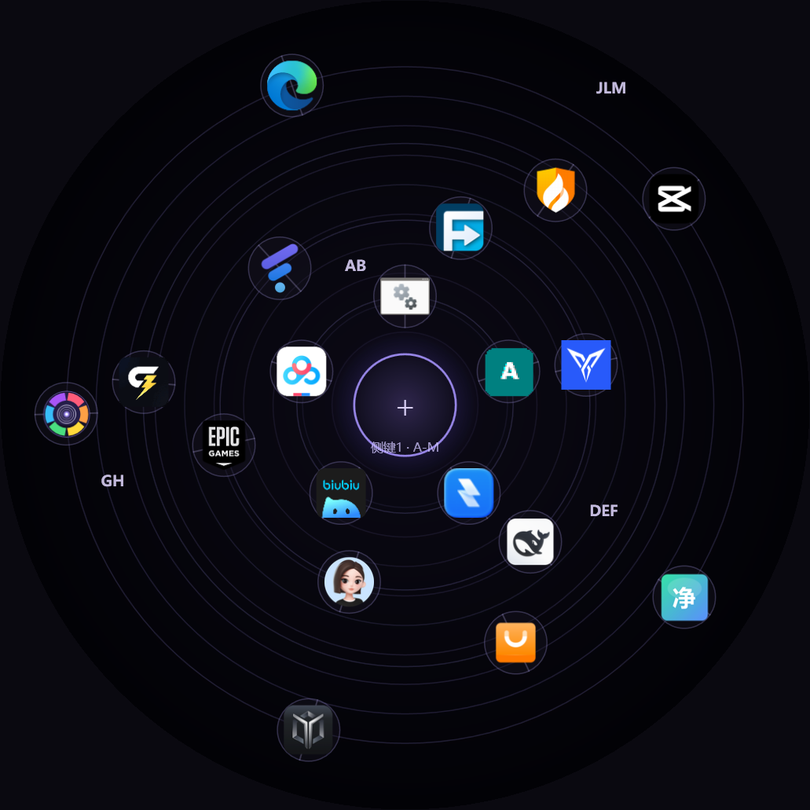

# 轮盘启动器 WheelLauncher

按住鼠标侧键（或 Tab+A / Tab+B）呼出一个大圆盘，桌面上的应用按**首字母**排成若干圆环，移动鼠标选中、松手即启动。不用桌面图标，也不用开始菜单。


## 截图

| 侧键 1 · A–M | 侧键 2 · N–Z |
| --- | --- |
|  |  |


## 功能

- **侧键拖出轮盘**：按住鼠标侧键超过设定时间（默认 650ms）才弹出，短按不会误触；弹出后继续按住，移动鼠标选中图标，松手启动，Esc 取消。
- **两个侧键各管一半**：侧键 1 → 首字母 **A–M** 的应用，侧键 2 → **N–Z** 的应用；每个盘内部再按首字母分环，从中心向外扩散。
- **没有侧键也能用**：按住 `Tab` 再按 `A` 或 `B` 呼出对应的盘（可在设置里关闭）。
- **选中反馈**：图标高亮 + 中心显示应用名 + 「哒」的一声（音量和开关都能调）。
- **中心「+」**：添加桌面上没有的程序（会记住，下次重扫不会丢）。
- **托盘常驻**：左键单击呼出轮盘，右键菜单有设置、重新扫描、添加应用、开机自启、退出；双击桌面快捷方式也会唤醒已运行的实例并弹出轮盘。
- **自动重扫**：每 3 分钟扫描一次桌面，新装的软件不用手动加。

## 使用方法

1. 双击 `WheelLauncher.exe`（首次运行会弹一个使用引导窗）。
2. 按住鼠标侧键约 0.65 秒，圆盘出现。
3. 继续按住不放，把鼠标移到目标图标上，松手。
4. 想调整判定时间 / 音量 / 音效 / Tab 快捷键：托盘图标右键 →「设置…」。

设置与自定义应用保存在 `%APPDATA%\WheelLauncher\`：

- `settings.ini`：`longpress`（250–2000 毫秒）、`volume`（0–100）、`sound`（0/1）、`tabhotkey`（0/1）、`firstrun`。
- `custom.txt`：通过中心「+」添加的应用，格式 `显示名|程序路径|启动参数`。
- `log.txt`：运行日志，排错时看这个。

## 构建

需要 Windows 10/11 x64 与 .NET Framework 4.8（系统自带），**不需要**安装 Visual Studio 或 .NET SDK。

```powershell
powershell -ExecutionPolicy Bypass -File .\build.ps1
```

`build.ps1` 会调用系统自带的 `csc.exe` 编译成单文件 exe，并嵌入 `wheel.ico`。

## 已知限制

- **只支持 x64**，界面全中文。
- exe **未做代码签名**：首次运行 Windows SmartScreen 会提示「未知发布者」，点「更多信息 → 仍要运行」即可。
- 程序会安装**全局键鼠钩子**（这是读取侧键和 Tab 组合键的唯一办法），个别杀毒软件可能报「可疑行为」，需要手动放行。
- 侧键必须是 Windows 标准的 XBUTTON1 / XBUTTON2。如果用罗技 Options+、雷蛇雷云等驱动把侧键改成了别的功能，程序就收不到。
- 纯本地程序，不联网、不上传任何数据。

## 许可证

MIT，见 [LICENSE](LICENSE)。
