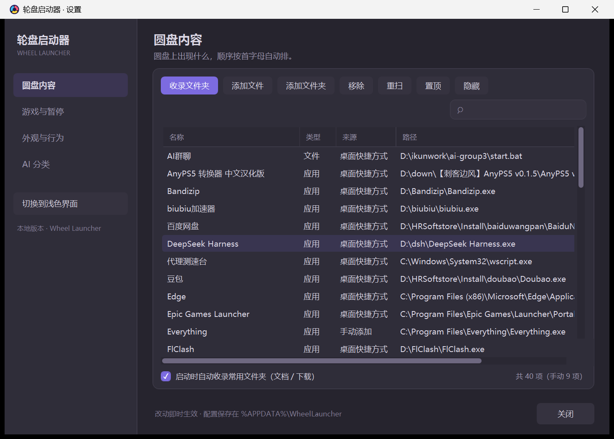
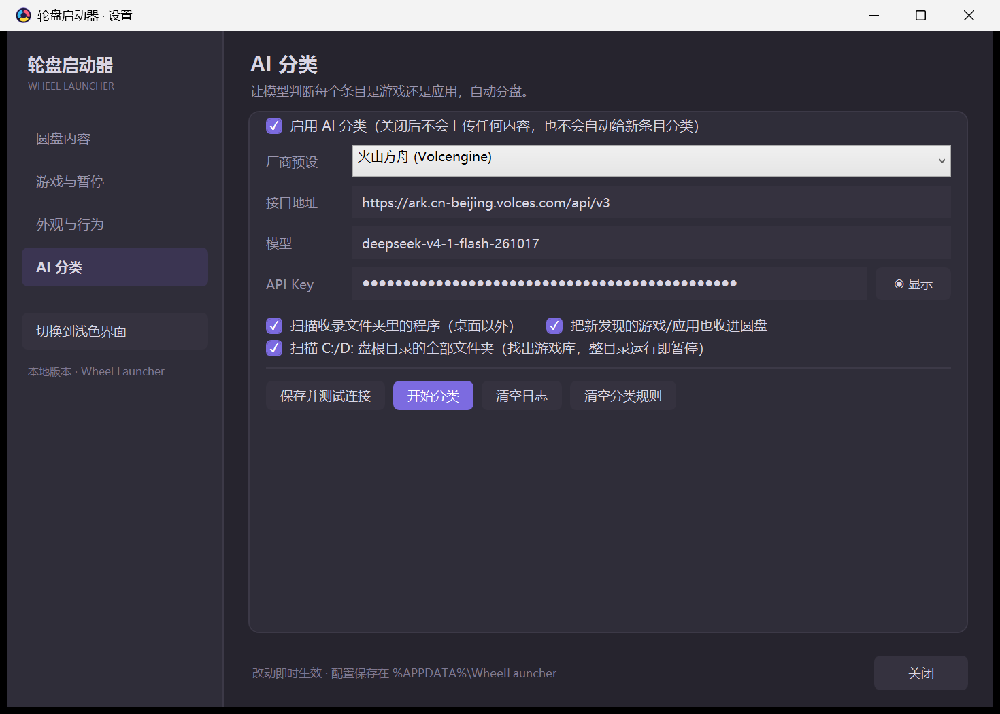
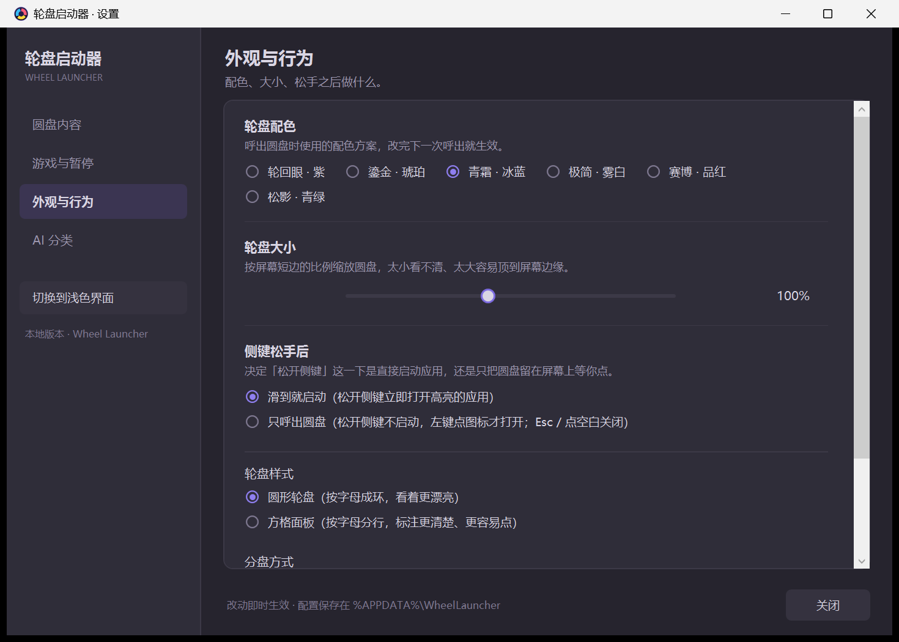

# 轮盘启动器 · Wheel Launcher

按住鼠标侧键 0.65 秒，屏幕上铺开一个按字母分环的轮盘，滑到哪个就开哪个。  
Windows 10 / 11 x64，单文件免安装，不依赖运行库。


## 下载

**[⬇ WheelLauncher-v0.2.0-win-x64.zip](../../releases/latest/download/WheelLauncher-v0.2.0-win-x64.zip)**（解压即用，约 260 KB）

## 三种呼出方式

| 方式 | 说明 |
|---|---|
| 鼠标侧键 | 按住侧键 **0.65 秒**（可调 250–2000ms）→ 侧键 1 出 **A–M**，侧键 2 出 **N–Z**；松开所选图标即启动 |
| 键盘 | **F7** = A–M 盘，**F8** = N–Z 盘；也可以 Ctrl+Alt+A / Ctrl+Alt+B；Tab+A / Tab+B 可选开启 |
| 手柄 | 左摇杆 / 十字键选择，**A** 启动，**B** 取消；**L3+View** 出 A–M，**L3+Start** 出 N–Z |

盘内操作：移动鼠标（或方向键 / 摇杆）→ 松开左键（或按 A / 回车）启动；**Esc** 关闭；点中心齿轮打开设置；点空白处只关闭，不启动。

急救：任何时候按 **Ctrl+Alt+Shift+F10**，强制关掉所有残留窗口。

## 界面



左侧导航分四页：

- **圆盘内容** — 排序、置顶（★）、隐藏、搜索、手动添加文件/文件夹、自动收录常用文件夹
- **游戏与暂停** — 什么情况下自动让开（见下）
- **外观与行为** — 6 套配色、70%–140% 大小、松手即启动 / 只呼出圆盘、圆形轮盘 / 方格面板、深色浅色主题
- **AI 分类** — 让模型判断条目是游戏还是应用，自动分盘





## 自动暂停：玩游戏时不打扰

轮盘在下列情况会**完全放行输入**（侧键、Tab、快捷键都不触发）：

- 前台是游戏目录里的程序，或经由 Steam / Epic / WeGame / Ubisoft / Battle.net / Riot 启动的游戏
- 前台是无边框全屏窗口（Direct3D 全屏或铺满显示器）
- 前台是加速器（biubiu 等，可在设置里关掉这条）

Steam / Epic 的**客户端窗口本身不算游戏**，不会被暂停；只有从它们启动的游戏才算。

## AI 分类（可选）

支持 8 家预设（火山方舟、DeepSeek、OpenAI、通义千问、月之暗面、智谱、硅基流动、自定义 OpenAI 兼容），填接口地址 / 模型 / Key 即可。

- 批量判断每个条目是 **game / app / folder**，结果自动分盘、并进「游戏与暂停」名单
- 请求默认关闭模型推理（`thinking: disabled`），一次分 30 条，约 700 tokens
- **规则沉淀**：判过的类别会生成「路径特征 → 类别」规则，下次同类路径直接命中、**不再调用接口**
- 名称清洗：`Microsoft Edge.exe` → `Edge`，去掉版本号、`(x64)`、「 - 快捷方式」等噪音
- 危险项过滤：安装器 / 卸载器 / 更新器 / 崩溃上报 / `vc_redist` 之类不会被收进圆盘
- 可扫描 C:/D: 盘根目录一级文件夹，识别出游戏库后**整目录加入暂停名单**
- 不想用就取消勾选「启用 AI 分类」，此时不上传任何内容

## 数据在哪

配置与数据都在 `%APPDATA%\WheelLauncher\`，纯文本，可手工编辑：

| 文件 | 作用 |
|---|---|
| `settings.ini` | 全部开关（长按毫秒、音量、主题、轮盘样式、分盘方式…） |
| `meta.txt` | 每条的置顶/排序/隐藏/分类（`路径\|置顶\|顺序\|隐藏\|盘\|类别`） |
| `games.txt` | 手动或 AI 认定的游戏（目录按前缀匹配，整目录生效） |
| `custom.txt` | 手动添加的条目 |
| `rules.txt` | AI 沉淀下来的分类规则 |
| `ai.txt` | AI 厂商配置（Key 明文，界面已掩码显示） |
| `log.txt` | 运行日志，超过 1MB 轮转 |

写入是原子的：先写临时文件再替换，成功写入会留一份 `.bak`；如果某个文件读失败，**不会**用空数据覆盖它，日志里会有一条 `write blocked (earlier read failed)`。

## 已知限制

- 未签名 exe：首次运行可能被 SmartScreen 拦一下，点「更多信息 → 仍要运行」
- 以管理员身份运行时，从圆盘启动的程序也会是管理员权限
- 多显示器且各屏缩放比例不同时，轮盘位置可能偏一点（不影响使用）
- 全局键鼠钩子依赖 Windows 低级钩子，个别安全软件可能拦截，日志里出现 `HOOK INSTALL FAILED` 即属此类

## 从源码构建

需要 .NET Framework 4.x 自带的 `csc.exe`（无需安装 VS / SDK）：

```powershell
powershell -ExecutionPolicy Bypass -File build.ps1
```

生成 `WheelLauncher.exe`（`/platform:x64 /optimize+`，内嵌 `wheel.ico`）。

## 许可

MIT，见 [LICENSE](LICENSE)。
