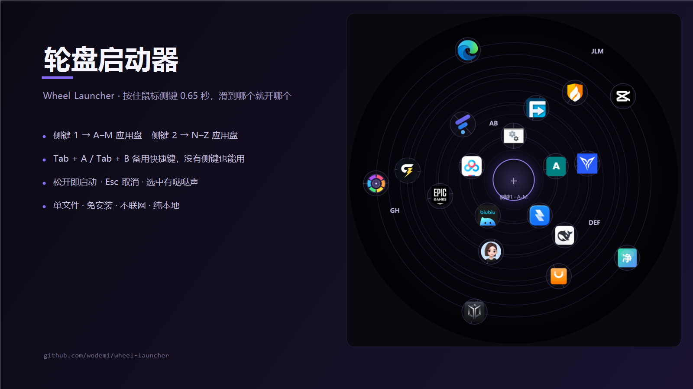
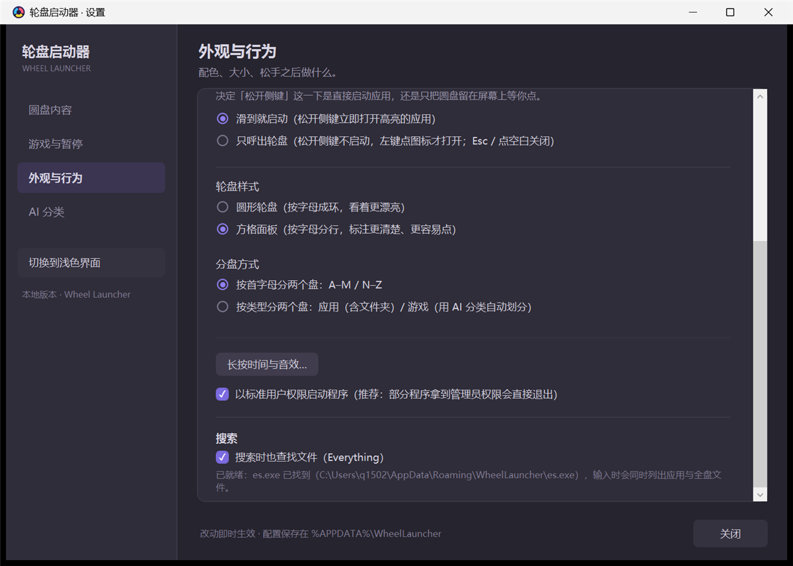
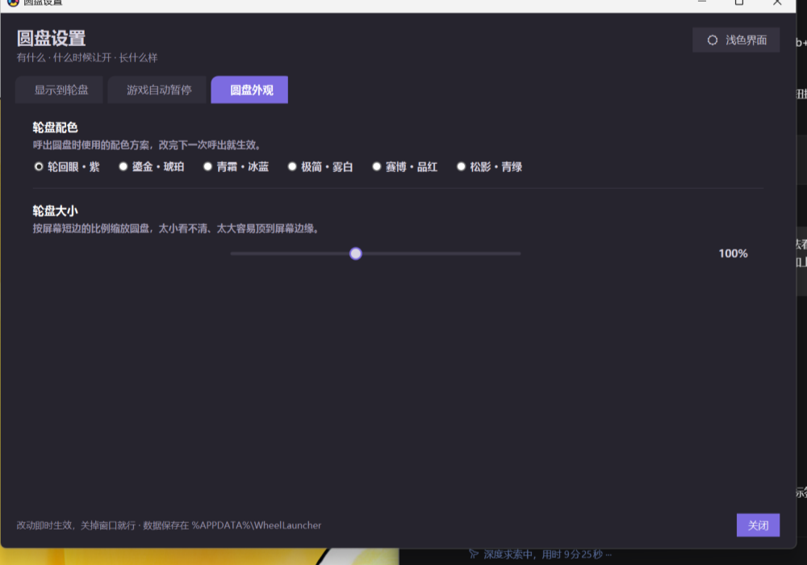

# 轮盘启动器 WheelLauncher

按住鼠标侧键（或 Tab+A / Tab+B）呼出一个大圆盘，桌面上的应用按**首字母**排成若干圆环，移动鼠标选中、松手即启动。不用桌面图标，也不用开始菜单。



## 下载

- **[WheelLauncher-v0.1.5-win-x64.zip](https://github.com/wodemi/wheel-launcher/releases/latest/download/WheelLauncher-v0.1.5-win-x64.zip)** — 约 150 KB，解压后双击 `WheelLauncher.exe` 就能用（.NET Framework 4.8 系统自带，无需安装任何运行库）。
- 历史版本与更新说明：[Releases](https://github.com/wodemi/wheel-launcher/releases)

## 截图

| 侧键 1 · A–M | 侧键 2 · N–Z |
| --- | --- |
|  |  |


中心「⚙」设置台：三页——显示到轮盘 / 游戏自动暂停 / 圆盘外观。

| 内容管理 | 外观自定义 |
| --- | --- |
|  |  |

## 功能

- **侧键呼出轮盘**：按住鼠标侧键超过设定时间（默认 650ms）才弹出，短按不会误触；弹出后继续按住，移动鼠标选中图标，松手启动，Esc 取消。
- **两种松手行为**（设置 → 圆盘外观）：
  - 滑到就启动：松开侧键立刻打开高亮项（默认）；
  - 只呼出圆盘：松开只把圆盘留在屏幕上，左键点图标才启动，Esc 或点空白关闭。
- **两个侧键各管一半**：侧键 1 → 首字母 **A–M**，侧键 2 → **N–Z**；每个盘内部再按首字母分环，从中心向外扩散。
- **没有侧键也能用**：按住 `Tab` 再按 `A` 或 `B` 呼出对应盘；呼出后点击图标启动，再按一次 Tab+A/B 不会重复弹（防屏闪），Esc 关闭。
- **选中反馈**：图标高亮 + 中心显示应用名 + 「哒」的一声（音量与开关可调）。
- **中心齿轮**：鼠标停在中心即高亮，左键点一下打开设置台（不要求先滑出去再滑回来）。
- **外观自定义**：6 套轮盘配色（轮回眼·紫 / 鎏金·琥珀 / 青霜·冰蓝 / 极简·雾白 / 赛博·品红 / 松影·青绿）、轮盘大小 70–140%，以及深色 / 浅色界面（设置窗右上角一键切换）。
- **自动收录文件夹**：首次运行把「文档 / 下载」放进圆盘，也可在设置里批量勾选桌面、各磁盘根目录下的文件夹；勾选一次后不再自动回填，删掉就是删掉。
- **托盘常驻**：左键单击呼出轮盘，右键菜单有设置、圆盘设置、重新扫描、添加应用、开机自启、退出；双击桌面快捷方式也会唤醒已运行的实例。
- **自动重扫**：每 3 分钟扫描一次桌面，新装的软件不用手动加。
- **打游戏自动让路**：检测到游戏（游戏目录下的程序，或无边框独占全屏）时，侧键与 Tab 快捷键全部原样放行，轮盘不弹、按键不吞；回到桌面自动恢复。可在托盘菜单或设置里关掉。

## 使用方法

1. 双击 `WheelLauncher.exe`（首次运行会弹使用引导窗）。
2. 按住鼠标侧键约 0.65 秒，圆盘出现；继续按住，把鼠标移到目标图标上，松手。
3. 想调整判定时间 / 音量 / 音效 / Tab 快捷键：托盘图标右键 →「设置…」。
4. 想改圆盘内容、游戏判定、配色与大小：托盘右键 →「圆盘设置…」，或呼出圆盘后点中心齿轮。

设置与自定义数据保存在 `%APPDATA%\WheelLauncher\`：

- `settings.ini`：`longpress`（250–2000 毫秒）、`volume`（0–100）、`sound`（0/1）、`tabhotkey`（0/1）、`theme`（0 浅色 / 1 深色）、`wheeltheme`（0–5 配色）、`wheelsize`（70–140）、`release`（0 滑到就启动 / 1 只呼出圆盘）、`autofolders`、`autopause`、`firstrun`、`foldersseed`。
- `custom.txt`：手动添加的应用与文件夹，格式 `显示名|路径|启动参数`。
- `games.txt`：手动标记为游戏的文件/文件夹（每行一个路径）。
- `log.txt`：运行日志，排错时看这个。

## 构建

需要 Windows 10/11 x64 与 .NET Framework 4.8（系统自带），**不需要**安装 Visual Studio 或 .NET SDK。

```powershell
powershell -ExecutionPolicy Bypass -File .\build.ps1
```

`build.ps1` 会调用系统自带的 `csc.exe` 编译成单文件 exe，并嵌入 `wheel.ico`。

## 已知限制

- **只支持 x64**，界面全中文。
- exe **未做代码签名**：首次运行 Windows SmartScreen 会提示「未知发布者」，点「更多信息 → 仍要运行」即可。
- 程序会安装**全局键鼠钩子**（这是读取侧键和 Tab 组合键的唯一办法），个别杀毒软件可能报「可疑行为」，需要手动放行。
- 侧键必须是 Windows 标准的 XBUTTON1 / XBUTTON2。如果用罗技 Options+、雷蛇雷云等驱动把侧键改成了别的功能，程序就收不到。
- 多显示器且各屏缩放比例不同时，轮盘的尺寸和位置按主屏 DPI 计算，副屏上可能偏大偏小。
- 圆盘显示期间，它覆盖的那块方形区域会接收左键：点图标=启动，点空白=关闭，点中心齿轮=设置。
- 纯本地程序，不联网、不上传任何数据。

## 许可证

MIT，见 [LICENSE](LICENSE).